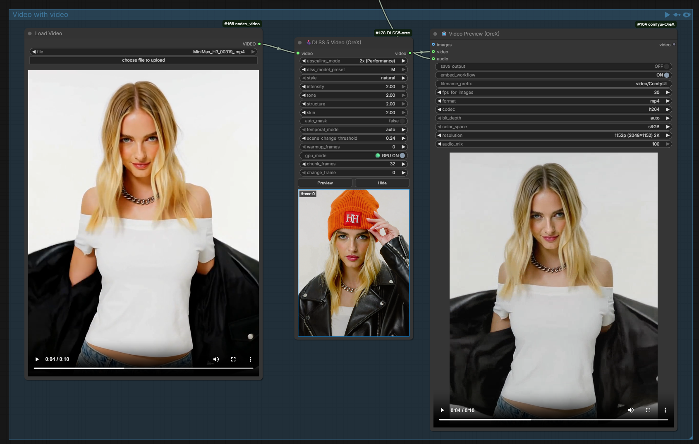

<p align="center">
  <a href="#english"><strong>English</strong></a> · <a href="#russian"><strong>Русский</strong></a>
</p>

<a id="english"></a>

<div align="center">

# 🕹️ ComfyUI-DLSS5-Ox

### Unofficial ComfyUI nodes for NVIDIA DLSS 5 Neural Rendering (NGX feature 18)

**In-process D3D12/NGX bridge, zero-PCIe CUDA interop path, and single-frame Preview — no helper processes, no temporary files.**



</div>

---

## About

**ComfyUI-DLSS5-Ox** is an unofficial, experimental ComfyUI custom-node package that brings NVIDIA **DLSS 5 Neural Rendering** (NGX feature 18) to ComfyUI workflows. Neural Rendering runs **in-process** inside ComfyUI through a small native D3D12 bridge: no helper executable is launched and no temporary image files are written.

Two nodes are provided, both in the `experimental → DLSS 5 NR` category:

- **🕹️DLSS 5 (OreX)** — for a **sequence of images**: takes an `IMAGE` batch input and returns an enhanced `IMAGE` batch;
- **🕹️DLSS 5 Video (OreX)** — for a **video stream**: takes a `VIDEO` input and returns an enhanced `VIDEO` (the same control set; frame rate, audio, and metadata pass through untouched).

The bridge between ComfyUI and `nvngx_dlssnr.dll` has been **fully rewritten** for this project and is **significantly optimized for speed and resource usage**.

> [!WARNING]
> This project targets an undocumented / pre-release NVIDIA interface and is not affiliated with, endorsed by, or supported by NVIDIA or Comfy Org. Runtime behavior may change with NVIDIA driver or `nvngx_dlssnr.dll` versions. Native driver/runtime failures can crash the ComfyUI process.

## What is DLSS 5 Neural Rendering?

**DLSS 5 Neural Rendering** (NGX feature 18) is NVIDIA's neural enhancement technology for images and video: a neural network reworks the source material — it adds micro-detail, cleans up textures, balances tone and lighting, and reduces artifacts — instead of simple resampling or an artificial sharpness pass.

For **AI-generated images and video**, it works as a post-processing pass: connect it after any generation model in a ComfyUI workflow and it polishes the result — it can reduce typical generative artifacts (plastic skin, "burnt-in" micro-noise, smeared fine details), recover sharpness, and bring the final frames closer to what reads as a natural image. Since it runs on the GPU right inside the workflow, there is no separate export/re-import step.

> [!NOTE]
> Neural Rendering is enhancement/post-processing, not generation: it improves what the model produced, it does not create new content. Output quality depends on the source, the selected runtime build, and the GPU/driver combination.

## Features

- 🕹️ **🕹️DLSS 5 (OreX)** — image-sequence node: `IMAGE` batch in, enhanced `IMAGE` batch out;
- 🎬 **🕹️DLSS 5 Video (OreX)** — video-stream node: `VIDEO` in, enhanced `VIDEO` out, with the identical per-frame pipeline;
- 🔁 bridge rewritten from scratch — the D3D12 bridge between ComfyUI and `nvngx_dlssnr.dll` is fully rewritten and significantly optimized for speed and resource usage;
- 🖥️ GPU coverage — built primarily for RTX 50 and RTX 40 series; also runs on RTX 30 and RTX 20 (slower);
- 🚀 in-process execution — the native D3D12 bridge (`dlss5nr_bridge.dll`) runs inside the ComfyUI process; no subprocesses, no disk round-trip;
- ⚡ zero-PCIe CUDA path — CUDA/D3D12 external-memory interop (shared-heap frame textures imported via `cuImportExternalMemory`, GPU-side handoff via an external semaphore): when the input tensor already sits on the bridge's GPU, pixels never leave VRAM;
- 💨 near real time — a 90-second video is processed in about 120 seconds on an RTX 5090; `chunk_frames` bounds peak memory, so even very long videos can be processed;
- 🛟 transparent fallback — if interop is unavailable or fails mid-run, the node automatically switches to the CPU staging path;
- 🧩 embedded PTX conversion kernels — `nvcuda.dll` is loaded at runtime; no CUDA toolkit installation is needed;
- 📈 output sizes up to 8K — upscaling modes from `1x (DLAA / native)` to `3x (Ultra Performance)`, 7680×4320 boundary;
- 🧠 Neural Rendering style and strength controls — `style`, `intensity`, `tone`, `structure`, `skin`, `auto_mask`;
- ⏱️ temporal history management — `auto` (reset on detected scene changes) or `none`, with a scene-change threshold and warmup frames;
- 🧮 memory-saving chunked processing — `chunk_frames` splits long sequences into chunks while temporal history carries across chunk boundaries (identical output, peak RAM/VRAM drops from O(batch) to O(chunk));
- 🖼️ single-frame **Preview** — queues only the subgraph feeding the node, processes one frame, and draws the result under the node; no downstream outputs and no prior run needed;
- 🟢 **GPU ON** / 🔴 **GPU OFF** toggle — controls whether CPU batches are moved into VRAM for faster staging;
- 💬 OreX-style hover tooltips in English and Russian for every widget.

## Quick Start

### Prebuilt release — recommended

You do not need Visual Studio, MSVC, the CUDA toolkit, or any other compiler. Everything the project owns is included in the release archive; you only supply your own Neural Rendering runtime.

1. Open the **Releases** page of this repository.
2. Download the latest `ComfyUI-DLSS5-Ox-vX.Y.Z-windows-x64.zip`.
3. Extract the contained `ComfyUI-DLSS5-Ox` folder to:

   ```text
   ComfyUI/custom_nodes/ComfyUI-DLSS5-Ox
   ```

4. Supply your own compatible, **legally obtained** NVIDIA Neural Rendering runtime:

   ```text
   ComfyUI-DLSS5-Ox/runtime/nvngx_dlssnr.dll
   ```

5. Restart ComfyUI.
6. Add **experimental → DLSS 5 NR → 🕹️DLSS 5 (OreX)** (and/or the video node).

> [!IMPORTANT]
> Do not download GitHub's automatically generated `Source code.zip` if you do not want to compile anything.

The release ZIP already contains the project-owned native files:

```text
bridge/bin/dlss5nr_bridge.dll        # prebuilt D3D12 + NGX + CUDA interop bridge
runtime/caller/nvngx.dll_comfy.dll   # project-owned caller helper
```

### `_nvngx.dll`

Do not normally copy `_nvngx.dll` yourself. The bridge attempts, in order:

1. `runtime/_nvngx.dll` as an explicit local override;
2. normal Windows DLL search;
3. automatic discovery in the active NVIDIA DriverStore packages matching `nv*.inf_*`.

The project does not redistribute `_nvngx.dll`.

### Developer build

The prebuilt `bridge/bin/dlss5nr_bridge.dll` and `runtime/caller/nvngx.dll_comfy.dll` ship with the project, so building is only needed if you change the bridge itself. The C++ sources live in `bridge/`. Rebuilding needs **only** Visual Studio 2022 Build Tools (Desktop development with C++) — no CUDA toolkit and no NGX SDK headers:

```powershell
powershell -ExecutionPolicy Bypass -File bridge\build_bridge.ps1
```

## Basic Usage

### Run an image

1. Add **🕹️DLSS 5 (OreX)** and connect an `IMAGE` to its input.
2. Pick the `upscaling_mode` (default `1.5x (Quality)`) and adjust the strength controls as needed.
3. Queue the workflow — the enhanced `IMAGE` appears on the node's output.

### Run a video

1. Add **🕹️DLSS 5 Video (OreX)** and connect a `VIDEO` to its input.
2. The same control set applies — the only difference is the wire type.
3. Queue the workflow — the node unwraps the video into frames, runs the identical per-frame pipeline, and re-wraps the result into a `VIDEO` with the original frame rate, audio, and metadata.
4. For long sequences keep `chunk_frames` at its default (64) or raise it; `0` processes the whole batch at once.

On an RTX 5090 a 90-second video takes roughly 120 seconds to process — close to real time. Because `chunk_frames` bounds peak memory, very long videos can be processed as well.

### Preview a single frame

1. Set `change_frame` to the frame index you want to inspect (0 = first frame).
2. Click the canvas-drawn **Preview** button under the node.
3. The node queues only the subgraph that feeds it (the rgthree-comfy "Queue Selected Output Nodes" pattern), processes just that one frame, and draws a PNG of the result under the buttons.
4. Click **Hide** to remove the preview image.

Preview temporal history starts fresh at the selected frame, so it is a fast parameter check, not a slice of a finished run. Downstream nodes are not part of the pruned prompt, so a preview writes no outputs.

## How It Works

```text
ComfyUI IMAGE / VIDEO
    -> Python/ctypes
    -> dlss5nr_bridge.dll
    -> D3D12 + NGX
    -> nvngx_dlssnr.dll (feature 18)
    -> ComfyUI IMAGE / VIDEO
```

Since v0.8.0 the nodes use **CUDA/D3D12 external-memory interop**: shared-heap frame textures are imported into CUDA via `cuImportExternalMemory`, and an external semaphore hands work between the GPU queues. When the input tensor already sits on the bridge's GPU, pixels never leave it:

```text
Torch tensor (GPU) -> PTX RGB->RGBA16F -> D3D12/NGX DLSS NR -> PTX RGBA16F->RGB -> Torch tensor (GPU)
```

The conversion kernels ship as embedded PTX and `nvcuda.dll` is loaded at runtime, so no CUDA toolkit installation is needed. If interop is unavailable for any reason (no `nvcuda.dll`, GPU mismatch, init failure) or fails mid-run, the node transparently falls back to the CPU staging path:

```text
Torch tensor -> CPU float32 -> D3D12 RGBA16F -> DLSS NR -> CPU float32 -> Torch tensor
```

There is no subprocess or disk round-trip either way.

## Node Parameters

Both nodes share the same control set and defaults (v0.9.28). Every widget has a hover tooltip in the OreX style (icon + name title, English line, Russian line, dark box with the signature blue border).

| Parameter | Options / range | Purpose |
|---|---|---|
| `upscaling_mode` | `1x (DLAA / native)` · `1.5x (Quality)` · `1.724x (Balanced)` · `2x (Performance)` · `3x (Ultra Performance)` | Output size relative to the source (default `1.5x (Quality)`). `1x` runs Neural Rendering at native resolution; larger modes resample the frame first and then run the neural pass at the target size (this bridge has no DLSS Super Resolution models). |
| `dlss_model_preset` | `Default` · `J` · `K` · `L` · `M` | Force a specific DLSS model instead of NVIDIA's choice, mirroring the reference enhancer (default `M`). **Reserved:** the current feature-18 runtime exposes no model-preset parameter in its NGX parameter table, so this control is validated but does not change output yet. |
| `style` | `natural` · `cinematic` · `default` | Neural Rendering style selector (default `natural`). |
| `intensity` | 0.0 – 2.0, step 0.05 | Overall Neural Rendering strength (default 1.0). Values above 1.0 have no further effect on current runtime builds; below 1.0 blends back towards the source. |
| `tone` | 0.0 – 2.0, step 0.05 | Local tone / lighting strength — `DLSSNR.LocalToneStrength` (default 2.0). |
| `structure` | 0.0 – 2.0, step 0.05 | Local structure / micro-detail strength — `DLSSNR.LocalStructureStrength` (default 2.0). Higher keeps more texture; 1.5 is a good balance for AI-generated footage. |
| `skin` | −1.0 – 2.0, step 0.05 | Skin-specific structure strength (default 2.0). `−1` leaves the runtime's default behavior. Only takes effect when `auto_mask` is on. |
| `auto_mask` | off / on | Automatic skin mask: lets the model detect the regions it treats as skin; gates `skin` (default off). |
| `temporal_mode` | `auto` · `none` | Temporal history management (default `auto`). `auto` resets the history on detected scene changes; `none` keeps history across all frames (reset only on the first one). |
| `scene_change_threshold` | 0.01 – 1.0, step 0.01 | Mean luminance change between consecutive frames above which the temporal history is reset (default 0.24). |
| `warmup_frames` | 0 – 16 | Extra re-evaluations after each history reset so temporal accumulation settles before the frame's output is kept (default 0). |
| `gpu_mode` | 🟢 GPU ON / 🔴 GPU OFF | **ON:** the bridge runs on the first NVIDIA GPU and a CPU input batch is moved into its VRAM before processing (faster staging, zero-PCIe path when CUDA interop is active) — only if batch + output fit the free VRAM. **OFF:** frames stay where they are; the bridge still runs on the first GPU (default ON). |
| `chunk_frames` | 0 – 256 | Memory-saving mode for long sequences (default 64). `0` = off — the whole batch is processed at once. `>0` = process that many frames per chunk and assemble the result into a single full-length tensor. Frames keep their order on the same bridge session, so temporal history carries across chunk boundaries exactly as in an unchunked run — identical output, no quality loss at the seams. Peak RAM/VRAM drops from input batch + output batch to one chunk + the output tensor (which must exist anyway). Rule of thumb: pick N so that N × out_h × out_w × 12 bytes ≈ 1–2 GiB. |
| `change_frame` | 0 – 100000 | Frame index for the **Preview** button below it (default 0 = first frame). Not used by a full run; an index beyond the end of the sequence takes the last frame. |

At `1x (DLAA / native)` the output resolution is identical to the input. Larger upscaling modes resample first and then enhance; this node is Neural Rendering / post-processing, not DLSS Super Resolution. Output is capped at the supported 7680×4320 (8K) boundary.

## System Requirements

| Component | Requirement / recommendation |
|---|---|
| Operating system | Windows 10 or Windows 11, 64-bit |
| GPU | NVIDIA RTX GPU — primary target: RTX 50 and RTX 40 series; also runs on RTX 30 and RTX 20 (slower) |
| Driver | Recent NVIDIA display driver |
| ComfyUI | ComfyUI with Python, PyTorch, and NumPy |
| Neural Rendering runtime | A compatible, **legally obtained** `nvngx_dlssnr.dll` (you supply it) |
| Internet | Not required at run time |

GPU support is determined by the specific Neural Rendering runtime you provide. Stock/pre-release builds may support only particular GPU generations. A `0xBAD00001` result means the runtime rejected the feature on the current GPU/runtime/driver combination.

This repository intentionally does not provide download links or mirrors for proprietary/leaked NVIDIA binaries.

## Folder Structure

```text
ComfyUI-DLSS5-Ox/
├── __init__.py               # node registration + Preview API routes
├── OreX_DLSS5.py             # 🕹️DLSS 5 (OreX) image node (Python, ctypes ABI)
├── OreX_DLSS5_video.py       # 🕹️DLSS 5 Video (OreX) video node
├── js/
│   ├── OreX_DLSS5.js         # EN/RU canvas tooltips + Preview/Hide controls
│   └── OreX_DLSS5_video.js   # the same for the video node
├── bridge/
│   ├── bin/
│   │   └── dlss5nr_bridge.dll    # prebuilt D3D12 + NGX + CUDA interop bridge
│   └── ...                     # bridge C++ sources (developer builds)
├── runtime/
│   ├── nvngx_dlssnr.dll      # ← you supply this
│   ├── caller/
│   │   └── nvngx.dll_comfy.dll   # project-owned caller helper
│   └── README.txt
├── requirements.txt          # numpy (PyTorch comes from ComfyUI)
├── PROJECT.md                # architecture and data-path documentation
├── CHANGELOG.md              # version history
├── THIRD_PARTY_NOTICES.md    # legal separation: project code vs NVIDIA material
├── LICENSE                   # MIT (project-owned code only)
└── README.md
```

## Troubleshooting

### `Native bridge is missing`

If you are a normal user, you probably installed GitHub's **Source code** archive instead of the prebuilt Windows release ZIP. Download the release asset instead.

### `nvngx_dlssnr.dll not found`

Place your compatible runtime at:

```text
runtime/nvngx_dlssnr.dll
```

This repository intentionally does not provide download links or mirrors for proprietary/leaked NVIDIA binaries.

### `Could not load NVIDIA NGX core _nvngx.dll`

The bridge searches the NVIDIA DriverStore automatically. As a diagnostic fallback, locate a driver copy:

```powershell
Get-ChildItem "$env:SystemRoot\System32\DriverStore\FileRepository" -Filter _nvngx.dll -Recurse -ErrorAction SilentlyContinue |
  Sort-Object LastWriteTime -Descending |
  Select-Object FullName, LastWriteTime, Length
```

A matching driver copy can be placed at `runtime/_nvngx.dll` as a local override. Do **not** rename `nvngx_dlss.dll`; it is a different component.

### `CreateFeature(18) failed: 0xBAD00001`

Feature not supported by the supplied runtime on the selected GPU/driver combination. Use a runtime that legitimately supports your configuration.

### `0xBAD00002`

The observed Neural Rendering snippet rejected the caller. The release includes the project-owned thin caller helper expected by this integration. If this occurs with an untouched release ZIP, open an issue and attach the full ComfyUI error log.

### Wrong / blue colors

The node compares both channel interpretations (RGB vs swapped R/B) against the source's low-frequency colour statistics and normally selects the plausible one automatically. If a build still returns visibly swapped channels, report it with the full ComfyUI error log.

### Output exceeds the supported boundary

The output is capped at the 7680×4320 (8K) boundary — the same as the reference DLSS 5 enhancer. Use a smaller `upscaling_mode` or a smaller source.

## Limitations

- this is an unofficial, experimental integration targeting an undocumented / pre-release NVIDIA interface;
- Windows only, and a compatible `nvngx_dlssnr.dll` must be supplied by you — this project does not redistribute NVIDIA binaries;
- quality and GPU support depend on the specific runtime build and the GPU/driver combination;
- `1x (DLAA / native)` outputs at input size — this is Neural Rendering / post-processing, not DLSS Super Resolution;
- `dlss_model_preset` is reserved and does not affect output on the current runtime builds;
- native driver/runtime failures can crash the ComfyUI process;
- preview temporal history starts fresh, so the previewed frame is a parameter check, not a slice of a finished run.

## Credits

- [ComfyUI](https://github.com/Comfy-Org/ComfyUI) — the host application;
- [NVIDIA DLSS / NGX](https://github.com/NVIDIA/DLSS) — public DLSS/NGX repository and reference material;
- [Zonnery/dlss5-nr-player](https://github.com/Zonnery/dlss5-nr-player) — experimental DLSS 5 Neural Rendering player;
- [lisitskyaa/ComfyUI-DLSS5-NR](https://github.com/lisitskyaa/ComfyUI-DLSS5-NR) (MIT) — NVIDIA Optical Flow session management, ported with modifications;
- [NIGos/dlss5-bridge](https://github.com/NIGos/dlss5-bridge) (MIT) — independent validation of the D3D11 function-table layout;
- [Comfy-Org/Nvidia_RTX_Nodes_ComfyUI](https://github.com/Comfy-Org/Nvidia_RTX_Nodes_ComfyUI) — NVIDIA RTX nodes for ComfyUI;
- [faisalkindi/DLSS5oneclick](https://github.com/faisalkindi/DLSS5oneclick) — used as a starting point for this project;
- [Blueforcer/ComfyUI-DLSS5-Enhancer](https://github.com/Blueforcer/ComfyUI-DLSS5-Enhancer) — used as a starting point for this project;
- [PyTorch](https://pytorch.org/) and [NumPy](https://numpy.org/) — tensor handling and CPU staging.

## License

The project's original source code is distributed under the [MIT License](LICENSE). NVIDIA trademarks, SDK/API names, and proprietary binaries are owned by NVIDIA and are **not** covered by this project's MIT license. This project does not redistribute `_nvngx.dll`, `nvngx_dlssnr.dll`, other `nvngx_*` NVIDIA runtime binaries, or NVIDIA NGX SDK headers. Before distributing or using this project, review the terms that apply to the NVIDIA software/runtime you use. See [`THIRD_PARTY_NOTICES.md`](THIRD_PARTY_NOTICES.md) and the legal notes in [`PROJECT.md`](PROJECT.md).

---

Let us know if you encounter a problem and we will do our best to fix it.

**by OreX**

<a id="russian"></a>

---

## Русская версия

<div align="center">

# 🕹️ ComfyUI-DLSS5-Ox

### Неофициальные ComfyUI-узлы для NVIDIA DLSS 5 Neural Rendering (NGX feature 18)

**In-process D3D12/NGX-мост, zero-PCIe путь CUDA interop и Preview одного кадра — без вспомогательных процессов и временных файлов.**


</div>

---

## О проекте

**ComfyUI-DLSS5-Ox** — неофициальный экспериментальный пакет кастомных узлов для ComfyUI, добавляющий **DLSS 5 Neural Rendering** NVIDIA (NGX feature 18) в workflow ComfyUI. Нейронный рендеринг выполняется **in-process**, непосредственно внутри ComfyUI, через небольшой нативный D3D12-мост: никаких вспомогательных исполняемых файлов и никаких временных файлов изображений.

В пакете два узла, оба в категории `experimental → DLSS 5 NR`:

- **🕹️DLSS 5 (OreX)** — для работы с **секвенцией изображений**: на входе батч `IMAGE`, на выходе улучшенный батч `IMAGE`;
- **🕹️DLSS 5 Video (OreX)** — для работы с **видеопотоком**: на входе `VIDEO`, на выходе улучшенное `VIDEO` (тот же набор управления; частота кадров, аудио и метаданные проходят без изменений).

Мост между ComfyUI и `nvngx_dlssnr.dll` **полностью переписан** для этого проекта и **значительно оптимизирован** по скорости и потреблению ресурсов.

> [!WARNING]
> Проект работает с **недокументированным / pre-release** интерфейсом NVIDIA и не связан с NVIDIA и Comfy Org, не является их продуктом и не поддерживается ими. Поведение рантайма может меняться в зависимости от версий драйвера NVIDIA и `nvngx_dlssnr.dll`. Сбои нативного драйвера/рантайма могут приводить к аварийному завершению процесса ComfyUI.

## Что такое DLSS 5 Neural Rendering?

**DLSS 5 Neural Rendering** (NGX feature 18) — нейронная технология NVIDIA для улучшения изображений и видео: нейросеть перерабатывает исходный материал — добавляет микродетали, очищает текстуры, балансирует тон и освещение, уменьшает артефакты — вместо простого ресемплинга или искусственного налёта резкости.

Для **AI-генерированных изображений и видео** она работает как проход постобработки: подключите её после любой модели генерации в workflow ComfyUI, и она «доведёт» результат — сгладит типичные генеративные артефакты (пластиковая кожа, «вгоревший» микروشум, смазанные мелкие детали), вернёт чёткость и сделает итоговые кадры ближе к естественным. Обработка идёт на GPU прямо внутри workflow — без отдельного экспорта и повторного импорта.

> [!NOTE]
> Neural Rendering — это улучшение/постобработка, а не генерация: она улучшает то, что создала модель, но не создаёт нового контента. Качество вывода зависит от исходника, выбранной сборки рантайма и комбинации GPU/драйвер.

## Возможности

- 🕹️ **🕹️DLSS 5 (OreX)** — узел для секвенции изображений: на входе батч `IMAGE`, на выходе улучшенный батч `IMAGE`;
- 🎬 **🕹️DLSS 5 Video (OreX)** — узел для видеопотока: `VIDEO` на входе, улучшенное `VIDEO` на выходе, с идентичным посткадровым конвейером;
- 🔁 мост переписан с нуля — D3D12-мост между ComfyUI и `nvngx_dlssnr.dll` полностью переписан и значительно оптимизирован по скорости и потреблению ресурсов;
- 🖥️ покрытие GPU — в первую очередь для серий RTX 50 и RTX 40; также работает на RTX 30 и RTX 20 (медленнее);
- 🚀 in-process-выполнение — нативный D3D12-мост (`dlss5nr_bridge.dll`) работает внутри процесса ComfyUI; без подпроцессов и без записи на диск;
- ⚡ zero-PCIe путь CUDA — CUDA/D3D12 external-memory interop (текстуры кадров в shared-heap, импорт через `cuImportExternalMemory`, GPU-сторона handoff через external semaphore): когда тензор входа уже находится на GPU моста, пиксели никогда не покидают видеопамять;
- 💨 близко к реальному времени — видео длительностью 90 секунд обрабатывается примерно за 120 секунд на RTX 5090; `chunk_frames` ограничивает пиковую память, поэтому можно обрабатывать и очень продолжительные видео;
- 🛟 прозрачный fallback — если interop недоступен или ломается посреди запуска, узел автоматически переключается на CPU staging-путь;
- 🧩 встроенные PTX-ядра конвертации — `nvcuda.dll` загружается во время выполнения; установка CUDA Toolkit не требуется;
- 📈 размеры вывода до 8K — режимы от `1x (DLAA / native)` до `3x (Ultra Performance)`, граница 7680×4320;
- 🧠 управление стилем и силой нейронного рендеринга — `style`, `intensity`, `tone`, `structure`, `skin`, `auto_mask`;
- ⏱️ управление временной историей — `auto` (сброс при обнаружении смены сцены) или `none`, порог смены сцены и warmup-кадры;
- 🧮 экономия памяти для длинных последовательностей — `chunk_frames` разбивает их на чанки, при этом временная история сохраняется через границы чанков (результат идентичен, пиковые RAM/VRAM снижаются с O(batch) до O(chunk));
- 🖼️ **Preview** одного кадра — ставит в очередь только подграф, питающий узел, обрабатывает один кадр и рисует результат под узлом; без выходных данных downstream-узлов и без предварительного запуска;
- 🟢 **GPU ON** / 🔴 **GPU OFF** — переключатель, управляющий тем, перемещаются ли CPU-батчи в видеопамять для быстрой staging-обработки;
- 💬 OreX-подсказки при наведении на каждый виджет — на английском и на русском.

## Быстрый запуск

### Предварительно собранный релиз — рекомендуется

Вам не нужны Visual Studio, MSVC, CUDA Toolkit или любой другой компилятор. Всё, что принадлежит проекту, уже находится в релизном архиве; вам остаётся только положить собственный рантайм нейронного рендеринга.

1. Откройте страницу **Releases** этого репозитория.
2. Скачайте актуальный `ComfyUI-DLSS5-Ox-vX.Y.Z-windows-x64.zip`.
3. Распакуйте содержащуюся папку `ComfyUI-DLSS5-Ox` в:

   ```text
   ComfyUI/custom_nodes/ComfyUI-DLSS5-Ox
   ```

4. Положите собственный совместимый, **законно полученный** рантайм NVIDIA Neural Rendering:

   ```text
   ComfyUI-DLSS5-Ox/runtime/nvngx_dlssnr.dll
   ```

5. Перезапустите ComfyUI.
6. Добавьте **experimental → DLSS 5 NR → 🕹️DLSS 5 (OreX)** (и/или видеовузлы).

> [!IMPORTANT]
> Если вы не хотите ничего компилировать, не скачивайте автоматически сгенерированный GitHub-архив `Source code.zip`.

В релизном ZIP уже находятся нативные файлы проекта:

```text
bridge/bin/dlss5nr_bridge.dll        # предсобранный мост D3D12 + NGX + CUDA interop
runtime/caller/nvngx.dll_comfy.dll   # caller-хелпер проекта
```

### `_nvngx.dll`

Обычно копировать `_nvngx.dll` самостоятельно не нужно. Мост пробует, по порядку:

1. `runtime/_nvngx.dll` как явный локальный override;
2. обычный Windows-поиск DLL;
3. автоматический поиск в активных пакетах NVIDIA DriverStore по шаблону `nv*.inf_*`.

Проект не распространяет `_nvngx.dll`.

### Developer-сборка

Предсобраннные `bridge/bin/dlss5nr_bridge.dll` и `runtime/caller/nvngx.dll_comfy.dll` поставляются вместе с проектом, поэтому собирать что-либо нужно только в том случае, если вы сами меняете мост. C++-исходники находятся в `bridge/`. Для пересборки достаточно **только** Visual Studio 2022 Build Tools (Desktop development with C++) — без CUDA Toolkit и без заголовков NGX SDK:

```powershell
powershell -ExecutionPolicy Bypass -File bridge\build_bridge.ps1
```

## Основное использование

### Запуск изображения

1. Добавьте **🕹️DLSS 5 (OreX)** и подключите `IMAGE` на вход.
2. Выберите `upscaling_mode` (по умолчанию `1.5x (Quality)`) и при необходимости подстройте силу обработки.
3. Запустите workflow — улучшенное `IMAGE` появится на выходе узла.

### Запуск видео

1. Добавьте **🕹️DLSS 5 Video (OreX)** и подключите `VIDEO` на вход.
2. Действует тот же набор управления — единственное отличие, это тип провода.
3. Запустите workflow — узел распаковывает видео в кадры, прогоняет их по тому же посткадровому конвейеру и собирает результат обратно в `VIDEO` с исходной частотой кадров, аудио и метаданными.
4. Для длинных последовательностей оставьте `chunk_frames` по умолчанию (64) или увеличьте его; `0` обрабатывает весь батч целиком.

На RTX 5090 видео длительностью 90 секунд обрабатывается примерно за 120 секунд — близко к реальному времени. Благодаря разбиению на чанки (`chunk_frames`) пиковая память остаётся ограниченной, так что можно обрабатывать и очень продолжительные видео.

### Preview одного кадра

1. Установите `change_frame` на индекс кадра, который хотите посмотреть (0 = первый кадр).
2. Нажмите нарисованную на холсте кнопку **Preview** под узлом.
3. Узел ставит в очередь только подграф, который его питает (паттерн "Queue Selected Output Nodes" из rgthree-comfy), обрабатывает только этот один кадр и рисует PNG-результат под кнопками.
4. Кнопка **Hide** убирает изображение превью.

Временная история Preview начинается заново с выбранного кадра, поэтому это быстрая проверка параметров, а не фрагмент готового прогона. Downstream-узлы не входят в обрезанный промпт, поэтому превью не пишет никаких выходных данных.

## Как это работает

```text
ComfyUI IMAGE / VIDEO
    -> Python/ctypes
    -> dlss5nr_bridge.dll
    -> D3D12 + NGX
    -> nvngx_dlssnr.dll (feature 18)
    -> ComfyUI IMAGE / VIDEO
```

С v0.8.0 узлы используют **CUDA/D3D12 external-memory interop**: текстуры кадров в shared-heap импортируются в CUDA через `cuImportExternalMemory`, а external semaphore передаёт работу между GPU-очередями. Когда тензор входа уже находится на GPU моста, пиксели никогда не покидают его:

```text
Torch tensor (GPU) -> PTX RGB->RGBA16F -> D3D12/NGX DLSS NR -> PTX RGBA16F->RGB -> Torch tensor (GPU)
```

Ядра конвертации поставляются встроенным PTX, `nvcuda.dll` загружается во время выполнения, поэтому установка CUDA Toolkit не требуется. Если interop по какой-либо причине недоступен (нет `nvcuda.dll`, несовпадение GPU, сбой инициализации) или ломается посреди запуска, узел прозрачно переключается на CPU staging-путь:

```text
Torch tensor -> CPU float32 -> D3D12 RGBA16F -> DLSS NR -> CPU float32 -> Torch tensor
```

В обоих случаях ни подпроцессов, ни записи на диск нет.

## Параметры узлов

Оба узла имеют одинаковый набор управления и значения по умолчанию (v0.9.28). На каждый виджет есть OreX-подсказка при наведении (иконка + заголовок, строка EN, строка RU, тёмный бокс с фирменной синей рамкой).

| Параметр | Диапазон / варианты | Назначение |
|---|---|---|
| `upscaling_mode` | `1x (DLAA / native)` · `1.5x (Quality)` · `1.724x (Balanced)` · `2x (Performance)` · `3x (Ultra Performance)` | Размер вывода относительно исходника (по умолчанию `1.5x (Quality)`). `1x` выполняет нейронный рендеринг в нативном разрешении; крупные режимы сначала ресемплируют кадр, затем прогоняют нейронный проход в целевом размере (у этого моста нет моделей DLSS Super Resolution). |
| `dlss_model_preset` | `Default` · `J` · `K` · `L` · `M` | Принудительно выбрать конкретную DLSS-модель вместо выбора NVIDIA, как в референсном enhancer (по умолчанию `M`). **Зарезервировано:** текущий runtime feature-18 не выставляет параметр выбора модели в своей таблице параметров NGX, поэтому параметр валидируется, но пока не влияет на вывод. |
| `style` | `natural` · `cinematic` · `default` | Выбор стиля нейронного рендеринга (по умолчанию `natural`). |
| `intensity` | 0.0 – 2.0, шаг 0.05 | Общая сила нейронного рендеринга (по умолчанию 1.0). Значения выше 1.0 в текущих сборках рантайма не дают дополнительного эффекта; ниже 1.0 — смешивание к исходному кадру. |
| `tone` | 0.0 – 2.0, шаг 0.05 | Сила локального тона / освещения — `DLSSNR.LocalToneStrength` (по умолчанию 2.0). |
| `structure` | 0.0 – 2.0, шаг 0.05 | Сила локальной структуры / микродеталей — `DLSSNR.LocalStructureStrength` (по умолчанию 2.0). Выше — больше текстуры; для AI-генерации хорошее равновесие даёт 1.5. |
| `skin` | −1.0 – 2.0, шаг 0.05 | Сила структуры для кожи (по умолчанию 2.0). `−1` оставляет поведение рантайма по умолчанию. Действует только при включённом `auto_mask`. |
| `auto_mask` | выкл / вкл | Автоматическая маска кожи: модель сама определяет области, которые обрабатывает как кожу; управляет `skin` (по умолчанию выкл). |
| `temporal_mode` | `auto` · `none` | Управление временной историей (по умолчанию `auto`). `auto` сбрасывает историю при обнаружении смены сцены; `none` держит историю на всех кадрах (сброс только на первом). |
| `scene_change_threshold` | 0.01 – 1.0, шаг 0.01 | Среднее изменение яркости между соседними кадрами, выше которого временная история сбрасывается (по умолчанию 0.24). |
| `warmup_frames` | 0 – 16 | Дополнительные повторные проходы после каждого сброса истории, чтобы накопление успело «устояться» до сохранения кадра (по умолчанию 0). |
| `gpu_mode` | 🟢 GPU ON / 🔴 GPU OFF | **ON:** мост работает на первом GPU NVIDIA, а CPU-батч перед обработкой перемещается в его видеопамять (быстрая staging, zero-PCIe путь при активном CUDA interop) — только если батч + вывод помещаются в свободную VRAM. **OFF:** кадры остаются там, где были; мост по-прежнему работает на первом GPU (по умолчанию ON). |
| `chunk_frames` | 0 – 256 | Режим экономии памяти для длинных последовательностей (по умолчанию 64). `0` = выкл — весь батч обрабатывается целиком. `>0` = обрабатывать по столько кадров за чанк и собрать результат в единый тензор полной длины. Кадры сохраняют порядок в одной сессии моста, поэтому временная история переходит через границы чанков так же, как и без чанков — результат идентичен, потери качества на швах нет. Пиковые RAM/VRAM падают с «входной батч + выходной батч» до «один чанк + тензор вывода» (который всё равно должен существовать). Правило: N × out_h × out_w × 12 байт ≈ 1–2 GiB. |
| `change_frame` | 0 – 100000 | Индекс кадра для кнопки **Preview** под ним (по умолчанию 0 = первый кадр). Не используется в полном прогоне; индекс за концом последовательности берёт последний кадр. |

При `1x (DLAA / native)` разрешение вывода совпадает с входным. Крупные режимы сначала ресемплируют кадр, затем улучшают его; это узел нейронного рендеринга / постобработки, а не DLSS Super Resolution. Вывод ограничен поддерживаемой границей 7680×4320 (8K).

## Системные требования

| Компонент | Требование / рекомендация |
|---|---|
| Операционная система | Windows 10 или Windows 11, 64-bit |
| GPU | NVIDIA RTX GPU — основная цель: серии RTX 50 и RTX 40; также работает на RTX 30 и RTX 20 (медленнее) |
| Драйвер | актуальный дисплейный драйвер NVIDIA |
| ComfyUI | ComfyUI с Python, PyTorch и NumPy |
| Рантайм Neural Rendering | совместимый, **законно полученный** `nvngx_dlssnr.dll` (полагается вами) |
| Интернет | не требуется во время работы |

Поддержка GPU определяется конкретным рантаймом нейронного рендеринга, который вы предоставляете. Stock/pre-release сборки могут поддерживать только определённые поколения GPU. Результат `0xBAD00001` означает, что рантайм отклонил feature на текущей комбинации GPU/рантайм/драйвер.

Этот репозиторий намеренно не предоставляет ссылки для скачивания или зеркала проприетарных/утёкших бинарников NVIDIA.

## Структура папки

```text
ComfyUI-DLSS5-Ox/
├── __init__.py               # регистрация узлов + API-роуты Preview
├── OreX_DLSS5.py             # 🕹️DLSS 5 (OreX) — узел изображений (Python, ctypes ABI)
├── OreX_DLSS5_video.py       # 🕹️DLSS 5 Video (OreX) — узел видео
├── js/
│   ├── OreX_DLSS5.js         # EN/RU canvas-подсказки + кнопки Preview/Hide
│   └── OreX_DLSS5_video.js   # то же для видеовузла
├── bridge/
│   ├── bin/
│   │   └── dlss5nr_bridge.dll    # предсобранный мост D3D12 + NGX + CUDA interop
│   └── ...                     # C++-исходники моста (для developer-сборок)
├── runtime/
│   ├── nvngx_dlssnr.dll      # ← полагается вами
│   ├── caller/
│   │   └── nvngx.dll_comfy.dll   # caller-хелпер проекта
│   └── README.txt
├── requirements.txt          # numpy (PyTorch поставляется вместе с ComfyUI)
├── PROJECT.md                # документация по архитектуре и путям данных
├── CHANGELOG.md              # история версий
├── THIRD_PARTY_NOTICES.md    # юридическое разделение: код проекта vs материалы NVIDIA
├── LICENSE                   # MIT (только код проекта)
└── README.md
```

## Решение проблем

### `Native bridge is missing`

Если вы обычный пользователь, скорее всего, вы установили GitHub-архив **Source code** вместо предсобранного Windows-релизного ZIP. Скачайте релизный ассет.

### `nvngx_dlssnr.dll not found`

Положите ваш совместимый рантайм в:

```text
runtime/nvngx_dlssnr.dll
```

Этот репозиторий намеренно не предоставляет ссылки для скачивания или зеркала проприетарных/утёкших бинарников NVIDIA.

### `Could not load NVIDIA NGX core _nvngx.dll`

Мост ищет NVIDIA DriverStore автоматически. Как диагностический fallback найдите копию из драйвера:

```powershell
Get-ChildItem "$env:SystemRoot\System32\DriverStore\FileRepository" -Filter _nvngx.dll -Recurse -ErrorAction SilentlyContinue |
  Sort-Object LastWriteTime -Descending |
  Select-Object FullName, LastWriteTime, Length
```

Найденную копию драйвера можно положить в `runtime/_nvngx.dll` как локальный override. **Не** переименовывайте `nvngx_dlss.dll` — это другой компонент.

### `CreateFeature(18) failed: 0xBAD00001`

Feature не поддерживается предоставленным рантаймом на выбранной комбинации GPU/драйвер. Используйте рантайм, который легально поддерживает вашу конфигурацию.

### `0xBAD00002`

Наблюдаемый сниппет Neural Rendering отклонил caller. В релиз включён тонкий caller-хелпер проекта, который ожидается этой интеграцией. Если это происходит с нетронутым релизным ZIP, создайте issue и приложите полный лог ошибок ComfyUI.

### Неверные / синие цвета

Узел сравнивает обе интерпретации каналов (RGB против переставленных R/B) с низкочастотной цветовой статистикой источника и обычно автоматически выбирает правдоподобную. Если какая-то сборка всё равно возвращает явно переставленные каналы, сообщите об этом, приложив полный лог ошибок ComfyUI.

### Вывод превышает поддерживаемую границу

Вывод ограничен границей 7680×4320 (8K) — той же, что у референсного DLSS 5 enhancer. Используйте меньший `upscaling_mode` или меньший исходный размер.

## Ограничения

- это неофициальная экспериментальная интеграция, работающая с недокументированным / pre-release интерфейсом NVIDIA;
- только Windows, и совместимый `nvngx_dlssnr.dll` полагается вами — проект не распространяет бинарники NVIDIA;
- качество и поддержка GPU зависят от конкретной сборки рантайма и комбинации GPU/драйвер;
- `1x (DLAA / native)` выдаёт размер, равный входному — это нейронный рендеринг / постобработка, а не DLSS Super Resolution;
- `dlss_model_preset` зарезервирован и не влияет на вывод в текущих сборках рантайма;
- сбои нативного драйвера/рантайма могут приводить к аварийному завершению процесса ComfyUI;
- временная история Preview начинается заново, поэтому кадр превью — это проверка параметров, а не фрагмент готового прогона.

## Благодарности

- [ComfyUI](https://github.com/Comfy-Org/ComfyUI) — host-приложение;
- [NVIDIA DLSS / NGX](https://github.com/NVIDIA/DLSS) — публичный репозиторий DLSS/NGX и справочные материалы;
- [Zonnery/dlss5-nr-player](https://github.com/Zonnery/dlss5-nr-player) — экспериментальный плеер DLSS 5 Neural Rendering;
- [lisitskyaa/ComfyUI-DLSS5-NR](https://github.com/lisitskyaa/ComfyUI-DLSS5-NR) (MIT) — управление сессией NVIDIA Optical Flow, перенесено с изменениями;
- [NIGos/dlss5-bridge](https://github.com/NIGos/dlss5-bridge) (MIT) — независимая валидация раскладки function-таблицы D3D11;
- [Comfy-Org/Nvidia_RTX_Nodes_ComfyUI](https://github.com/Comfy-Org/Nvidia_RTX_Nodes_ComfyUI) — узлы NVIDIA RTX для ComfyUI;
- [faisalkindi/DLSS5oneclick](https://github.com/faisalkindi/DLSS5oneclick) — использован как стартовая точка проекта;
- [Blueforcer/ComfyUI-DLSS5-Enhancer](https://github.com/Blueforcer/ComfyUI-DLSS5-Enhancer) — использован как стартовая точка проекта;
- [PyTorch](https://pytorch.org/) и [NumPy](https://numpy.org/) — работа с тензорами и CPU staging.

## Лицензия

Первоначальный исходный код проекта распространяется по [лицензии MIT](LICENSE). Товарные знаки NVIDIA, названия SDK/API и проприетарные бинарники принадлежат NVIDIA и **не** покрываются лицензией MIT этого проекта. Проект не распространяет `_nvngx.dll`, `nvngx_dlssnr.dll`, другие бинарники рантайма `nvngx_*` NVIDIA и заголовки NVIDIA NGX SDK. Прежде чем использовать или распространять этот проект, ознакомьтесь с условиями, применимыми к используемому вами программному обеспечению/рантайму NVIDIA. Подробности — в [`THIRD_PARTY_NOTICES.md`](THIRD_PARTY_NOTICES.md) и в юридических примечаниях [`PROJECT.md`](PROJECT.md).

---

Сообщите о проблеме, и мы постараемся её исправить.

**by OreX**
